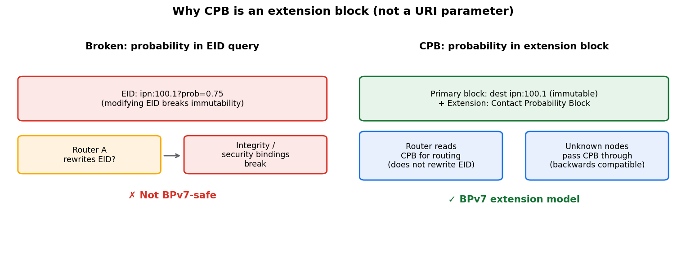
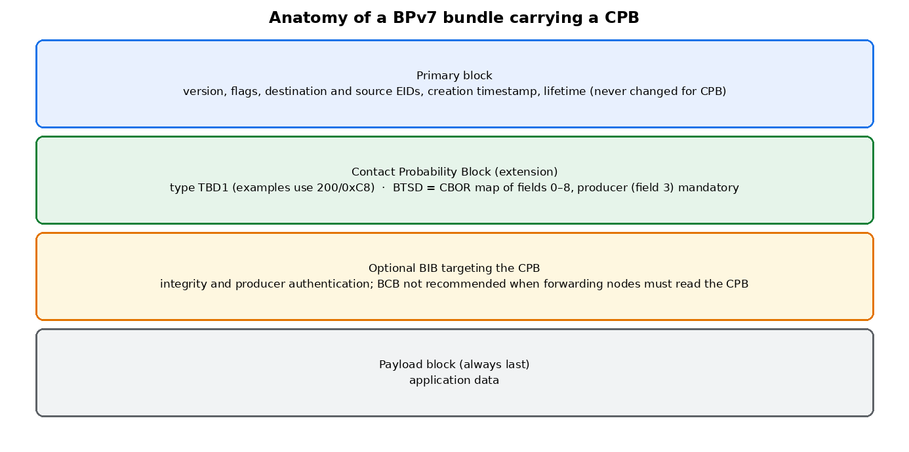
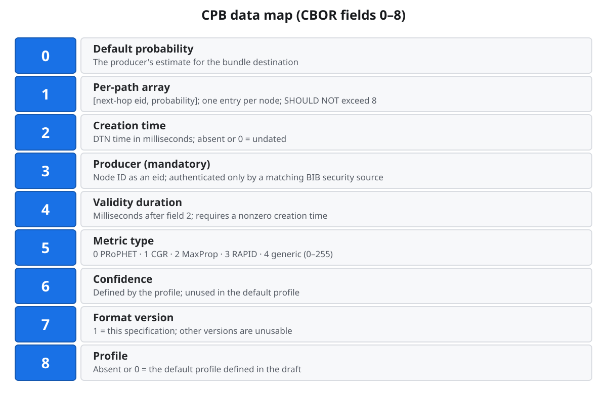
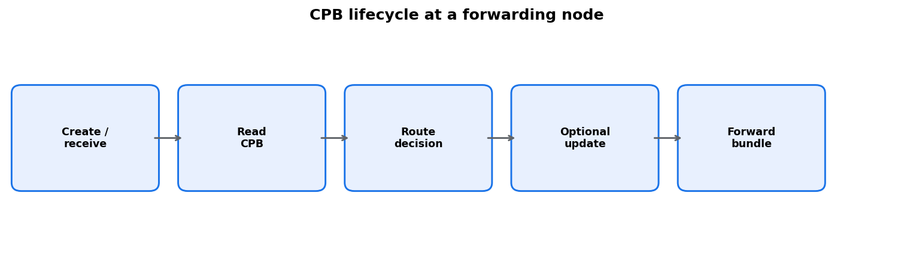

# Contact Probability Block (CPB) — Quick Reference

Short visual introduction to the CPB Internet-Draft
(*Probabilistic Contact Metadata for DTN Bundle Routing*): problem, wire
format, lifecycle, experimental plan, and security defaults.

See [`draft-perry-dtn-cpb.xml`](../draft-perry-dtn-cpb.xml). Pre-submission
review copy (not on the IETF Internet-Drafts repository).

---

## 1. The problem in one sentence

DTN contacts are often **uncertain**, but BPv7 endpoint IDs must stay
**immutable** — so probability must not be stuffed into the destination URI.

### Why not put it in the destination EID?

The ipn URI has no query component (RFC 9758 §4.1), ipn elements must not
carry routing information (RFC 9758 §7.5), and rewriting the primary block
breaks BIBs that cover it. CPB puts estimates in an **extension block**
instead.

---

## 2. What CPB is

CPB is a **BPv7 extension block** that carries *in-bundle* probability /
confidence metadata between nodes. It is a **transport for estimates**, not
a replacement for CGR, PRoPHET, MaxProp, or similar protocols.

Those protocols can **produce or consume** CPB data while keeping their own
algorithms. CPB is only the **in-bundle scalar** ([0,1] labelled with producer, metric
type, and profile).
Encounter tables, contact plans, summary vectors, Spray copy-count **L**,
and MaxProp hop-lists stay in each protocol’s control plane (draft §5).

- Open questions (noise, adversaries, multi-domain trust, production interop)
  are listed in the draft and not claimed solved.
- Examples use block type **200 (0xC8)**; IANA assigns the permanent code.
  Implementations **must not** hardcode `0xC8`.

---

## 3. What’s inside a CPB (fields 0–8)

The block-type-specific data is a **CBOR map**:

| Key | Meaning |
|-----|---------|
| 0 | Default probability: the producer's estimate for the bundle destination |
| 1 | Per-path `[next-hop, probability]` list; next hops are RFC 9171 `eid` node IDs, one entry per node (senders **SHOULD NOT** exceed 8) |
| 2 | Creation time: DTN time in milliseconds; absent or 0 means undated |
| 3 | Producer node ID (`eid`), **mandatory**; a claim until a BIB authenticates it |
| 4 | Validity in milliseconds after field 2; requires a nonzero field 2 |
| 5 | Metric type (0 PRoPHET · 1 CGR · 2 MaxProp · 3 RAPID · 4 generic), 0–255 |
| 6 | Confidence, defined by the profile (unused in the default profile) |
| 7 | Format version (1 = this specification; other versions are unusable) |
| 8 | Profile; absent or 0 = the default profile defined in the draft |

Unknown keys above 8 are ignored. Under the **default profile**, values are the
producer's own estimates, field 0 is about the destination, a path entry for N
is about forwarding from the producer to N, and higher is better. Values of
different metric types or profiles have no common scale.

Next hops match by node: ipn by (allocator, node) with the service number
ignored, dtn by node-name. `dtn:none` and the ipn LocalNode EID are not allowed.

---

## 4. Lifecycle at a router

1. **Create or receive** a bundle that may carry one or more CPBs.
2. **Check** format, version, metric type, profile, time limits, and trust/BIB
   policy. An unusable CPB is treated as absent for routing and forwarded
   unchanged. Among CPBs from the same producer, metric type, and profile, the
   latest creation time wins.
3. **Decide** next hop using your routing policy.
4. **Optionally add** a CPB naming yourself as producer to a nonfragment
   bundle, using the draft's append-only or security-acceptor
   strip-and-replace model. Never modify another producer's CPB.
   Protected fragment CPBs retain their authenticated bytes; when they cannot
   be authenticated before reassembly, routing falls back to local state.
5. **Forward**; a node that does not implement CPB keeps the block and
   forwards it unchanged when bit 4 (discard if unprocessable) is clear.
   Producers must not set bit 4 on a CPB that is or will be a BIB target.

---

## 5. Planned experiments

The draft proposes future evaluation of routing behavior, estimate quality,
feedback stability, interoperability, and security processing. Comparisons
will use matched baselines and documented scenarios, metrics, and methods.

These experiments have not been performed for this draft. No experimental
results or demonstrated performance improvement are claimed. Development
check commands are documented in the repository README.

---

## 6. Security (draft §7)

Threats include false probabilities (sinkhole / blackhole), stale CPBs,
semi-trusted relays biasing routes, and inter-domain trust gaps.

- Prefer **BPSec BIB** authentication on CPBs used for routing. Authenticated
  use requires binding the CPB to its bundle and authorizing the credential
  to assert the producer identity. HMAC protection uses effective scope **7**.
- Field 3 must name the BIB's security source. Shared HMAC keys only prove
  group membership; per-producer attribution needs per-producer or pairwise
  keys, or signatures.
- **Should not** encrypt a CPB with BCB when forwarding nodes must read it.
- Only the security acceptor may remove a protected CPB.
- Unauthorized or unverifiable CPBs: prefer **strict** handling (ignore the
  estimate for routing and use local state). Core BP/BPSec validation and
  security policy still govern the bundle's processing outcome.
- Multi-CPB precedence applies **after** trust verification.
- Do not add a new BIB to a fragment. Primary-bound CPBs may need reassembly
  before authentication can succeed.

---

## 7. Recap

**Why is probability not allowed in the destination EID?**
The ipn URI has no query, its elements must not carry routing information,
and rewriting the primary block breaks BIBs. Put estimates in an extension
block instead.

**Name three CPB map fields and what they mean.**
Examples: **0** default probability; **1** per-path `[next-hop, probability]`
list; **5** metric-type (which semantic family the scalar belongs to). Also
common: **2** creation time (ms), **3** producer, **4** validity (ms),
**7** format version, **8** profile.

**Can values of different metric types be compared?**
No. A PRoPHET predictability and a CGR confidence have no common scale, and
the draft defines no way to combine them (draft §3.5).

**What is still open?**
Noisy or adversarial estimates, multi-domain trust, partial deployment
quality, and production-stack interoperability.
